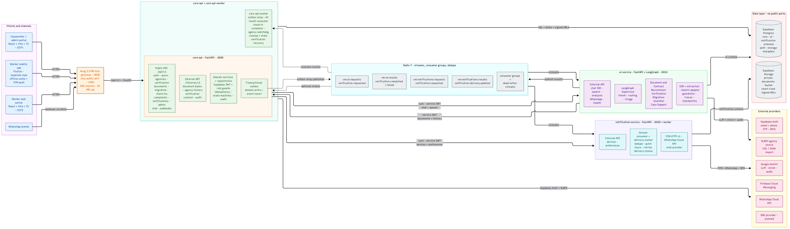
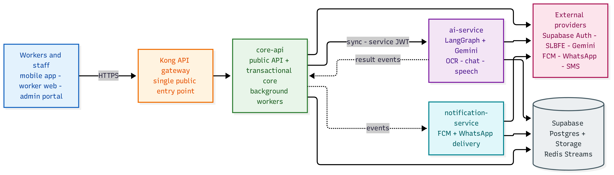

# VideshaMitra — Architecture Diagrams

Two views of the same system, in one place:

- **Large** — the detailed container view: every deployable, data store, event
  stream, and external provider.
- **Small** — the at-a-glance view: the main parts and how they talk.

Both views are generated from the Mermaid sources in
[`diagrams/`](diagrams/). The architecture is the target design; implementation
status is tracked in [`docs/progress.md`](../progress.md).

---

## 1. Large architecture (detailed)

[](diagrams/architecture-large.svg)

*Click the image for the full-resolution SVG. Editable source:
[architecture-large.mmd](diagrams/architecture-large.mmd).*

### What is in each zone

| Zone | Components | Responsibility |
|---|---|---|
| **Clients** | Worker mobile app (Flutter, separate repo), worker web portal (`:5173`), admin portal (`:5174`), WhatsApp worker | Worker journeys, staff casework, camera/voice capture, offline cache, push |
| **Edge** | Kong 3.9 DB-less gateway (`:8000`) | The only public entry point: routing, CORS, 600 req/min, 30 MB request cap |
| **Transactional core** | `core-api` (FastAPI) and `core-api-worker` | Public `/api/v1`, internal `/internal/v1`, domain logic, auth guards, idempotency, outbox, audit; background relay/results/check-ins/watchdog/cleanup |
| **Async backbone** | Redis 7 Streams | Verification and notification events, consumer groups, dedupe, dead letters |
| **AI runtime** | `ai-service` (FastAPI + LangGraph, `:8010`) | Supervisor plus four agents, OCR/extraction, Gemini calls, chat SSE, speech, guardrails, traces, checkpoints |
| **Delivery runtime** | `notification-service` (`:8020`) plus worker | Device tokens, preferences, quiet hours, FCM/WhatsApp delivery, retries, delivery status |
| **Data** | Supabase Postgres and Storage | One schema per service, private document bucket, short-lived signed URLs; no public ports |
| **External providers** | Supabase Auth, SLBFE, Gemini, FCM, WhatsApp Cloud API, SMS | Identity, agency source data, LLM/vision/audio, push and messaging |

### Communication paths

| From → To | Mode | Auth | Purpose |
|---|---|---|---|
| Clients → Kong | HTTPS | Supabase public JWT (auth endpoints excepted) | All worker and staff API calls |
| WhatsApp → Kong | HTTPS webhook | `X-Hub-Signature-256` | Inbound messages, forwarded to `ai-service` |
| Kong → `core-api` | HTTP `:8000` | Internal network boundary | `/api/v1` and `/health` only; `/ready` stays private |
| `core-api` ↔ `ai-service` | REST + SSE | Service JWT (`aud=ai-service`) | Chat, speech, AI trace lookup |
| `ai-service` → `core-api` | REST | Service JWT (`aud=core-api`) | Document bytes, agency history, verification context |
| `core-api` ↔ `notification-service` | REST | Service JWT (`aud=notification-service`) | Device registration and preferences |
| `core-api` → Redis | `XADD` via outbox relay | Internal network | Publish verification and notification requests |
| Redis → `ai-service` | `XREADGROUP` | Consumer group `ai-service` | Consume `verification.requested` |
| `ai-service` → Redis | `XADD` | Internal network | Publish `verification.completed` / `failed` |
| Redis → `core-api-worker` | `XREADGROUP` | Consumer group `core-api` | Consume AI results |
| Redis → `notification-service` | `XREADGROUP` | Notification consumer group | Consume delivery requests |
| `core-api` / worker → Postgres, Storage | SQL, HTTPS | `core_api_role`, signed URLs | Transactional data, blobs, audits |
| `ai-service` → Postgres | SQL | `ai_service_role` | Runs, traces, chat, checkpoints |
| `notification-service` → Postgres | SQL | `notification_service_role` | Devices, preferences, deliveries |
| `core-api` → Supabase Auth, SLBFE | HTTPS | Server-side keys | Login/OTP/JWKS, agency import and watchdog |
| `ai-service` → Gemini | HTTPS | `GEMINI_API_KEY` | LLM, vision, audio |
| `notification-service` → FCM, WhatsApp, SMS | HTTPS | Provider credentials | Push and messaging delivery |

### Event streams

| Stream | Producer | Consumer | Event types | Failure handling |
|---|---|---|---|---|
| `vm:ai:requests` | `core-api` outbox relay | `ai-service` | `verification.requested` | Durable outbox, retries, dead-letter |
| `vm:ai:results` | `ai-service` | `core-api-worker` | `verification.completed`, `verification.failed` | Dedupe by `event_id`; DLQ after 5 attempts |
| `vm:notifications:requests` | `core-api` | `notification-service` | `notification.requested` | Bounded retries, dead-letter, delivery status |
| `vm:notifications:results` | `notification-service` | `core-api` (optional) | `notification.delivery.updated` | Optional status feed |

Every event uses the envelope `{event_id, event_type, version, occurred_at,
producer, trace_id, data}`. The event type has no `.v1` suffix; `version`
carries the schema version.

### Data ownership

| Data | Owner | Store |
|---|---|---|
| Users, roles, consents, agencies, verifications, document metadata, journeys, check-ins, complaints, in-app notifications, audit, outbox, idempotency | `core-api` | `core` schema |
| AI runs, traces, OCR text, chat sessions/messages, LangGraph checkpoints, rules, fingerprints | `ai-service` | `ai` schema |
| Device tokens, preferences, delivery attempts/status | `notification-service` | `notification` schema |
| Identities and credentials | Supabase Auth | `auth` schema |
| Document blobs | Supabase Storage | Private `documents` bucket |

Services reference each other by ID only. There are no cross-schema joins or
foreign keys.

### Non-negotiable rules

1. Only `core-api` is public, through Kong. `ai-service` and
   `notification-service` have no public routes.
2. One schema and one runtime role per service.
3. AI work is asynchronous: Redis Streams plus a transactional outbox; OCR/LLM
   calls never run inside a public request.
4. `core-api` owns complaints, check-ins, the agency watchdog, and the in-app
   feed; `notification-service` owns delivery.
5. Public auth is a Supabase JWT; internal calls use short-lived service JWTs.
6. At-least-once delivery with consumer dedupe; no distributed transactions.

---

## 2. Small architecture (at a glance)

[](diagrams/architecture-small.svg)

*Click the image for the full-resolution SVG. Editable source:
[architecture-small.mmd](diagrams/architecture-small.mmd).*

Migrant workers and SLBFE staff reach one public gateway. Kong forwards everything to
`core-api`, which owns the transactional core and the background workers.
`core-api` calls `ai-service` for chat and speech, and publishes verification
jobs over Redis Streams; `ai-service` returns results as events. Notification
delivery is handled by `notification-service` from events. Supabase provides
Postgres, Storage, and Auth; Redis Streams is the async backbone; Gemini, SLBFE,
FCM, WhatsApp, and SMS are external providers. Only `core-api` is public.

### The five things to remember

1. **One door:** clients only call Kong → `core-api`.
2. **Three services:** transactional core, AI runtime, delivery runtime.
3. **Two paths:** synchronous REST/SSE for fast calls, Redis Streams for long
   AI jobs and notification fan-out.
4. **One owner per dataset:** `core`, `ai`, and `notification` schemas; ID-only
   references.
5. **Two identities:** Supabase public JWTs for people, short-lived service JWTs
   for service-to-service calls.

---

## 3. Diagram conventions

- Solid arrows are synchronous calls or direct data access; dotted arrows are
  asynchronous or optional paths.
- Colors: clients blue, edge orange, core green, AI purple, delivery teal, data
  grey, external providers pink.
- The large view is logical, not a network diagram. Locally, Compose runs
  `core-api`, its worker, `ai-service`, `notification-service` and its worker,
  Redis, and Kong; only Kong publishes a host port. Supabase runs outside
  Compose via the CLI.
- Rendering uses [Mermaid](https://mermaid.js.org/). Regenerate the assets with:

  ```bash
  npx --yes @mermaid-js/mermaid-cli \
    -i docs/architecture/diagrams/architecture-large.mmd \
    -o docs/architecture/diagrams/architecture-large.svg -b white
  npx --yes @mermaid-js/mermaid-cli \
    -i docs/architecture/diagrams/architecture-large.mmd \
    -o docs/architecture/diagrams/architecture-large.png -b white --size 3600 -s 1.5

  npx --yes @mermaid-js/mermaid-cli \
    -i docs/architecture/diagrams/architecture-small.mmd \
    -o docs/architecture/diagrams/architecture-small.svg -b white
  npx --yes @mermaid-js/mermaid-cli \
    -i docs/architecture/diagrams/architecture-small.mmd \
    -o docs/architecture/diagrams/architecture-small.png -b white --size 2200 -s 1.5
  ```

### Implementation status

| Area | Status |
|---|---|
| `core-api`, workers, database, admin portal | Implemented; live Supabase verification pending |
| `notification-service` | Implemented; live FCM/WhatsApp verification pending |
| `ai-service` | In progress |
| Worker web portal | Scaffold |
| Worker mobile app | Separate repository |
| Production deployment | Not yet |

See [`docs/progress.md`](../progress.md) for the current, detailed status.

---

## 4. Related documents

- [System architecture](system-architecture.md) — context, flows, data,
  security, deployment, reliability
- [Microservice architecture](microservices.md) — boundaries, ownership, events
- [Architecture overview](overview.md) — short service summary
- [API endpoints](../api/endpoints.md)
- [Database schema](../database/schema.md)
- [Multi-agent AI specification](../ai-agents/multi-agent-spec.md)
- [Worker mobile app contract](../mobile/overview.md)
- [Project progress](../progress.md)
