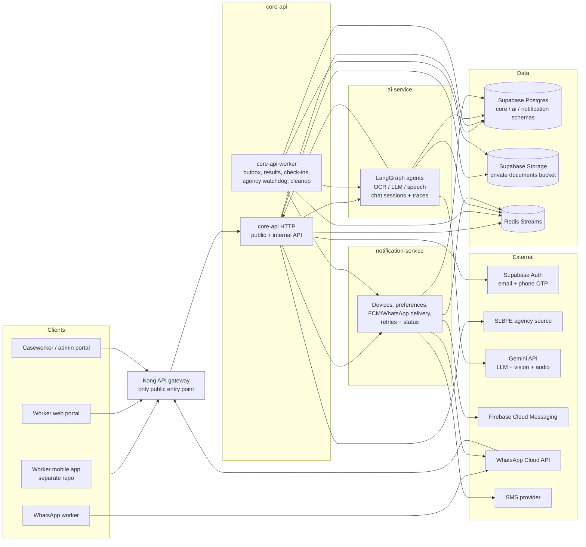
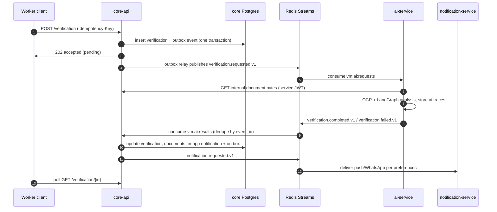
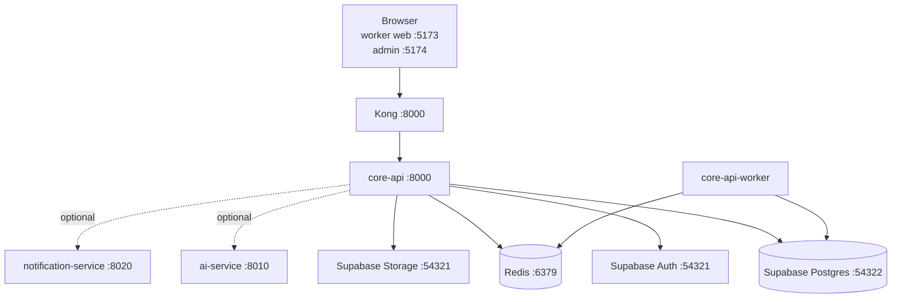

# VideshaMitra — System Architecture

> **Scope:** the whole platform at a high level — clients, edge, services, data,
> integrations, security, operations, and evolution.
>
> **Deep dives:** service boundaries and events in
> [`microservices.md`](microservices.md); task-level execution in
> [`docs/progress.md`](../progress.md). This document is the broad architectural
> view that ties those pieces together.

---

## 1. What the system is

VideshaMitra is a trilingual (Sinhala, Tamil, English) migration-safety
companion for Sri Lankan workers. It supports the worker journey **before,
during, and after** overseas employment:

- Verify recruitment agencies and job offers against SLBFE data.
- Read contracts, job offers, receipts, and screenshots with AI assistance.
- Run consent-based Day 7/30/90 safety check-ins.
- Detect high-risk or missed check-ins and escalate to a human caseworker.
- Let workers file complaints with evidence and track case progress.
- Alert workers when an agency license changes.
- Give caseworkers and admins a review, escalation, and audit console.
- Provide AI chat and voice interaction in the worker's language.

The platform is deliberately split into three deployables so the transactional
core, the AI workload, and notification delivery can fail and scale
independently.

---

## 2. Architectural goals and constraints

| Goal | Architectural response |
|---|---|
| One stable API for web, mobile, and admin | Kong → `core-api`; only `core-api` is public |
| Long AI jobs must not block requests | Redis Streams + transactional outbox; async verification |
| Reliable notifications without mixed ownership | `core-api` owns the in-app feed; `notification-service` owns delivery |
| Strong data ownership | One schema/role per service; ID-only references; no cross-schema joins |
| Worker privacy and consent | Consent history, RLS defense-in-depth, PII-minimal logs |
| Low-connectivity workers | Async jobs, polling endpoints, mobile-first contract, deep links |
| Two-person team operability | Boring infrastructure, one database cluster locally, explicit runbooks |
| Safe retries | Idempotency keys, consumer dedupe, outbox retries, dead-letter streams |
| Auditable staff actions | Append-only audit log with actor/entity IDs and request context |
| Trilingual product | `en`/`si`/`ta` in users and notification events; localized AI output |

**Planning assumptions (not contractual SLOs):**

- Single region, one Postgres cluster locally, separate databases recommended in
  production.
- Initial scale is thousands of workers, not millions; stateless services can be
  replicated horizontally.
- AI latency is seconds to minutes; verification results are polled or delivered
  as notifications rather than held open on HTTP.
- The worker mobile app lives in a separate repository and consumes the same
  `/api/v1` contract.

---

## 3. System context

**Trust rule:** clients only call Kong → `core-api`. `ai-service` and
`notification-service` are internal and must never receive a Kong route.
`ai-service` may call back into `core-api` only with a service JWT.

---

## 4. Logical layers

| Layer | Components | Responsibility |
|---|---|---|
| Client | Worker mobile, worker web, admin portal | UX, localization, camera/voice capture, offline cache |
| Edge | Kong | Routing, CORS, rate limits, request-size limits, single public origin |
| Public application | `core-api` | AuthN/Z, validation, transaction boundaries, orchestration, public DTOs |
| Domain | `core-api` services/repositories | Users, agencies, verification state, documents, journeys, cases |
| Async application | `core-api-worker` | Outbox relay, AI results, check-in scheduling, license watchdog, cleanup |
| AI runtime | `ai-service` | LangGraph, OCR/extraction, LLM, speech, chat sessions, traces |
| Delivery runtime | `notification-service` | Device tokens, preferences, channel delivery, retries, status |
| Data | Postgres, Storage, Redis | Durable state, blobs, streams/queues |
| External providers | Supabase Auth, SLBFE, Gemini, FCM, WhatsApp, SMS | Identity, source data, intelligence, delivery |

Each layer only depends on contracts from the layer below it. Public DTOs do not
leak database rows or another service's models.

---

## 5. Service catalog

| Service | Runtime | Public | Owns | Depends on |
|---|---|---|---|---|
| `core-api` | FastAPI/uvicorn | **Yes** via Kong | `core` schema, `documents` bucket metadata, public API, admin API | Postgres, Redis, Supabase Auth/Storage, ai-service, notification-service |
| `core-api-worker` | Same image, different command | No | Background processing only | Postgres, Redis, AI/notification clients |
| `ai-service` (planned) | FastAPI + LangGraph | No | `ai` schema: runs, traces, OCR text, chat, checkpoints, rules, fingerprints | Postgres, Redis, Gemini, core-api document bytes |
| `notification-service` (planned) | FastAPI worker | No | `notification` schema: tokens, preferences, deliveries, attempts | Postgres, Redis, FCM, WhatsApp, SMS |
| Kong | Kong OSS, DB-less | Edge | Routing, CORS, rate/size limits | core-api |
| Supabase | CLI local / managed production | Infrastructure | Postgres, Auth, Storage | — |
| Redis | Redis 7 | Infrastructure | Streams, event backlog, dead letters, lightweight rate limits | — |

**Implementation status (see [`progress.md`](../progress.md)):** `core-api` is
implemented end to end against its plan; the admin portal is implemented;
`notification-service` is a documented placeholder; `ai-service` is owned by
Person 2 and not yet implemented in this repository.

---

## 6. Core request and event flows

### 6.1 Staff login and authorization

1. Admin portal calls `POST /api/v1/auth/login` on `core-api`.
2. `core-api` proxies to Supabase Auth with the anon key and returns the session.
3. The portal stores the access/refresh tokens and sends
   `Authorization: Bearer <access_token>` on every call.
4. `core-api` verifies the JWT (HS256 local secret or cached JWKS), loads
   `core.users`, rejects inactive accounts, and applies role guards.
5. Worker accounts are rejected by the admin portal and by staff-only routes.
6. Refresh and logout are also proxied through `core-api`.

Public JWTs carry Supabase's `aud=authenticated`. Internal service JWTs carry
`aud` equal to the target service name and are signed with
`INTERNAL_JWT_SECRET`; they are never accepted as public tokens.

### 6.2 Document upload and download

1. Worker uploads a PDF/JPEG/PNG with `Idempotency-Key` to
   `POST /api/v1/documents`.
2. `core-api` enforces size, MIME/extension, magic-byte, and PDF page limits;
   computes SHA-256; rejects duplicates and empty/spoofed files.
3. The blob is written to the private `documents` bucket at
   `{user_id}/{document_id}/{filename}`; metadata goes to `core.documents`.
4. Only the owner or staff can request a short-lived signed URL; access is
   audited.
5. `ai-service` fetches bytes through
   `GET /internal/v1/documents/{id}/content` with a service JWT; the access is
   audited and the content never appears in logs.
6. Soft delete marks metadata and removes the blob; evidence lists stop showing
   it.

### 6.3 Verification (async AI)

The verification state machine is
`pending → processing → verified | suspicious | fraudulent | failed`.
Results are written only from a valid prior state, which makes duplicate or
late events harmless. Core never sets `processing` today, so the worker
re-queues verifications stuck in `pending` or `processing` past
`STALE_PROCESSING_MINUTES` (new `event_id`, same `verification_id`), and marks
them `failed` (`analysis_timeout`) after `MAX_VERIFICATION_RETRIES`. A
high-risk AI verdict does not open a case yet (change request CR-8).

### 6.4 Check-ins and escalation

1. Worker creates a journey and grants check-in consent. Revoking consent stops
   further check-ins and missed-check-in escalation.
2. `core-api` schedules Day 7/30/90 check-ins from the departure date.
3. The scheduler worker finds due check-ins with `FOR UPDATE SKIP LOCKED`, marks
   them sent, creates a feed item, and emits `notification.requested.v1`.
4. Worker responds through `POST /checkins/{id}/respond` with an idempotency key.
5. A high-risk response creates or escalates a tier-2 complaint and notifies
   staff. A check-in still unanswered after the grace period is marked `missed`
   and escalated exactly once.
6. Caseworkers review the resulting case in the admin portal, add notes, assign
   it, and escalate or resolve it.

### 6.5 Notification delivery

- In-app feed rows are written synchronously by `core-api`.
- Delivery is requested asynchronously via `notification.requested.v1`, which
  includes user ID, locale, type, title, body, data, deep link, and channels.
- `core-api` filters WhatsApp out if the worker has not granted WhatsApp consent.
- `notification-service` owns device tokens, preferences, quiet hours, retries,
  and delivery status. `core-api` proxies device/preference calls and stores no
  tokens.

### 6.6 Chat and speech

1. Client calls `core-api /api/v1/chat/*`.
2. `core-api` authenticates, checks that any `attachments` are the caller's own
   documents, and proxies to `ai-service` internal endpoints with a service JWT
   and correlation IDs. Only Kong's global rate limit applies; per-user chat
   quotas belong to `ai-service`.
3. Chat messages stream back as SSE; core does not persist chat content.
4. Speech uploads are validated for size/type before transcription; synthesized
   audio is streamed/returned without exposing `ai-service`.
5. The admin trace proxy exposes AI run metadata to staff only and audits access.

### 6.7 WhatsApp webhook

1. Meta calls Kong → `core-api /webhooks/whatsapp`.
2. `core-api` verifies the `X-Hub-Signature-256` HMAC when a secret is configured.
3. Provider message IDs are deduped in `core.event_dedupe`.
4. The verified payload is forwarded to `ai-service` with a service JWT.
5. Core waits for `ai-service` to accept the forward (30 s timeout) and returns
   any upstream error to Meta, which then retries. `ai-service` must therefore
   acknowledge with 2xx immediately and process the message asynchronously.

---

## 7. Data architecture

### 7.1 Ownership

| Data | Owner | Store |
|---|---|---|
| Users, roles, consent history | `core-api` | `core.users`, `core.user_consents` |
| Idempotency, outbox, dedupe | `core-api` | `core.idempotency_keys`, `core.outbox_events`, `core.event_dedupe` |
| Agencies, snapshots, license history | `core-api` | `core.agencies`, `core.agency_snapshots`, `core.agency_license_history` |
| Verifications, findings/evidence | `core-api` | `core.verifications` |
| Document metadata | `core-api` | `core.documents` |
| Document blobs | Supabase Storage | private `documents` bucket |
| Journeys, check-ins | `core-api` | `core.migration_journeys`, `core.checkins` |
| Complaints/cases, notes, evidence links | `core-api` | `core.complaints`, `core.case_notes`, `core.complaint_documents` |
| In-app notifications | `core-api` | `core.notifications` |
| Audit trail | `core-api` | `core.audit_logs` (append-only from the app) |
| AI runs, OCR text, traces, chat, checkpoints | `ai-service` | `ai` schema |
| Devices, preferences, delivery attempts/status | `notification-service` | `notification` schema |
| Identity credentials | Supabase Auth | `auth` schema |
| Raw blobs | Supabase Storage | `storage` schema + bucket |

There are no cross-schema joins or foreign keys. A service stores another
service's identifier as an opaque UUID and treats it as a reference only.

### 7.2 Core invariants

- One active journey per worker (`partial unique index where stage <> 'returned'`).
- One check-in per journey/due-time pair.
- One live document per `(user_id, sha256)`; deleted documents are exempt.
- One idempotency row per `(user_id, key)`; concurrent retries either replay the
  stored response or return `request_in_progress`.
- Verification and complaint status changes go through explicit transition maps.
- Audit rows are append-only; the application role cannot update or delete them.
- Object paths start with the worker's user ID, enforced again by Storage RLS.

### 7.3 Migrations and roles

- Migrations live in `services/core-api/migrations/` (`001`–`010`) and are
  applied by `python -m app.db.migrate`, checksum-guarded and idempotent.
- `supabase/bootstrap.sql` creates `core_api_role`, `ai_service_role`, and
  `notification_service_role`.
- `core` has RLS enabled on all tables. The backend uses `core_api_role`; direct
  Supabase clients use `authenticated` + `auth.uid()` policies.
- Local development may use one Postgres cluster with three schemas. Production
  should use separate databases or at minimum separate credentials and network
  policies.

### 7.4 Consent and PII

- Consent is historical, not a single boolean: type, granted/revoked, version,
  timestamp, IP, and user agent.
- WhatsApp delivery is skipped unless the latest WhatsApp consent is granted.
- Logs carry IDs, status, latency, and route — never document text, full phone
  numbers, or complaint bodies.
- Document downloads and AI document access are audited.

---

## 8. Integration architecture

### 8.1 Synchronous internal REST

| Caller | Callee | Purpose | Auth |
|---|---|---|---|
| `core-api` | `ai-service` | Chat sessions/SSE, STT, TTS, AI trace | Service JWT `aud=ai-service` |
| `core-api` | `notification-service` | Device register/unregister, preferences | Service JWT `aud=notification-service` |
| `ai-service` | `core-api` | Document bytes, license history, verification context | Service JWT `aud=core-api` |

Timeouts and error mapping are centralized in
`services/core-api/app/integrations/base.py`. Upstream failures surface as
`502 upstream_error`, not internal stack traces.

### 8.2 Asynchronous events

| Stream | Producer | Consumer | Events |
|---|---|---|---|
| `vm:ai:requests` | `core-api` | `ai-service` | `verification.requested.v1` |
| `vm:ai:results` | `ai-service` | `core-api` | `verification.completed.v1`, `verification.failed.v1` |
| `vm:notifications:requests` | `core-api` | `notification-service` | `notification.requested.v1` |
| `vm:notifications:results` | `notification-service` | `core-api` (optional) | `notification.delivery.updated.v1` |

**Envelope:** `event_id`, `event_type`, `version`, `occurred_at`, `producer`,
`trace_id`, `data`.

**Delivery guarantees:**

- Domain write + outbox insert are one database transaction.
- Relay publishes with `FOR UPDATE SKIP LOCKED`; rows are marked published only
  after `XADD`.
- Retries use bounded exponential backoff; exhausted rows/events go to a
  dead-letter stream.
- Consumers insert `(consumer, event_id)` in `core.event_dedupe` inside the same
  transaction as their side effects.
- Contract schemas are generated from Pydantic models into
  `packages/contracts/schemas/`; CI fails if they are stale.

---

## 9. Security architecture

### 9.1 Trust zones

| Zone | Components | Exposure |
|---|---|---|
| Edge | Kong | Public `:8000` |
| Application | `core-api`, `core-api-worker`, `ai-service`, `notification-service` | Docker/K8s internal network |
| Data | Postgres, Redis, Storage | No public ports |
| External | Supabase Auth, providers | Outbound over HTTPS |

Only Kong publishes a host port. Compose runs Kong, `core-api`,
`core-api-worker` and Redis; Supabase runs outside Compose via the CLI.

### 9.2 Authentication and authorization

- **Public identity:** Supabase Auth. `core-api` verifies signature, expiry,
  audience, and (when configured) issuer.
- **Roles:** `worker`, `caseworker`, `admin` live in `core.users`, not in the
  token.
- **Internal identity:** short-lived HS256 service JWTs with `iss`, `aud`, `sub`,
  `iat`, `exp`; tokens living longer than 300 s are rejected, and the
  document-content, agency-history and verification-context routes accept only
  `iss=ai-service`. One shared secret is used today; per-peer secrets are on
  Person 1's backlog before `notification-service` ships.
- **Ownership checks:** every worker-owned read/write verifies the row owner or
  staff role in the service layer.
- **RLS:** defence in depth for direct Supabase access. Workers can read their
  own rows; writes to verifications, documents, journeys, check-ins, complaints
  and storage objects go only through `core-api` (migration `011`).
- **Environment:** `ENVIRONMENT` defaults to `production`. Dev OTP, dev tokens,
  unsigned webhooks and the local Supabase JWT secret work only in
  `development`/`test`; startup fails if they are configured elsewhere.
- **Privilege protection:** a database trigger blocks `role`/`is_active` changes
  from non-backend roles.

### 9.3 Input and abuse controls

- Kong rate limits (600/min) and a 30 MB request cap; application upload cap is
  25 MB.
- OTP request/verify and login are rate-limited by IP (Kong's last
  `X-Forwarded-For` hop) and by hashed phone/email in Redis. OTP limits fail
  closed when Redis is unavailable.
- Files are checked by magic bytes, extension, declared MIME, size, and PDF page
  count; duplicate SHA-256 uploads are rejected.
- WhatsApp webhooks require a valid HMAC signature outside development/test.
- SQL is explicit and parameterized; dynamic sort columns come from allow-lists.
- Idempotency keys prevent duplicate verifications, uploads, check-ins, and
  complaints.

### 9.4 Secrets and operational hygiene

- Secrets come from environment variables; `.env` is gitignored.
- Service-role keys are server-only and never sent to browsers.
- Internal JWTs are minted per call and never logged.
- Signed URLs are short-lived, private-bucket only.
- Audit metadata is restricted to IDs and action context.

---

## 10. Deployment architecture

### 10.1 Local topology

- Supabase runs via the Supabase CLI (`supabase start`).
- `docker compose` runs `core-api`, `core-api-worker`, Redis, and Kong.
- `ai-service` and `notification-service` join the internal network when their
  scaffolds land; they must not publish host ports.
- Kong is the only public API entry point.

### 10.2 Production recommendation

- One container/process per service: `core-api`, `core-api-worker`,
  `ai-service`, `notification-service`, `notification-worker`.
- Managed Postgres (separate database per service, or separate credentials and
  network rules), managed Redis, private object storage.
- Kong or an equivalent managed gateway at the edge; TLS terminated at the edge.
- Per-service health checks, migrations, secrets, and CI/CD pipelines.
- Horizontal scaling for stateless HTTP services; single-writer semantics for
  schedulers/relays unless leases are added.
- Backups: Postgres PITR, bucket versioning/lifecycle, Redis persistence for
  stream durability.

### 10.3 Configuration and startup order

1. Provision Postgres, Auth, Storage, Redis, and secrets.
2. Apply `supabase/bootstrap.sql`.
3. Run core migrations (`python -m app.db.migrate`).
4. Seed/import reference data (SLBFE import, demo seed).
5. Start `core-api`, then `core-api-worker`.
6. Start internal services; add them to the network and health checks.
7. Point Kong at `core-api`; verify `/health` through Kong and `/ready` from
   inside the network (Kong does not route `/ready`).

`/health` is liveness. `/ready` checks Postgres, Redis, and storage, and reports
internal-client status; it returns `503` if a critical dependency is unavailable.

---

## 11. Reliability and failure modes

| Failure | Impact | Mitigation |
|---|---|---|
| `ai-service` down | Verifications stay queued | Durable outbox/stream, retry, stale-processing recovery, polling |
| Redis down | New events cannot publish; workers stall | Outbox retains pending rows; readiness fails; restart/retry |
| `notification-service` down | Push/WhatsApp delayed | Stream retention, consumer retry, dead-letter, in-app feed still works |
| Postgres down | All API writes fail | Readiness fails; managed backups/PITR; no split-brain writes |
| Storage down | Upload/download fail | Readiness fails; metadata never written before blob upload succeeds |
| Duplicate event | Double side effects | `event_dedupe` in the same transaction |
| Duplicate client retry | Duplicate records | DB idempotency keys + stored responses |
| Missed check-in | Worker at risk, no response | Grace period, `missed` state, tier-2 case, staff notification |
| Stale `pending`/`processing` verification | Worker waits forever | Worker requeues after timeout; `failed` after the retry cap |
| Webhook replay | Duplicate AI messages | Provider message ID dedupe |
| Chat disconnect | Broken stream | SSE proxy propagates disconnects, upstream context closes |
| Oversized/malicious upload | Cost/storage abuse | Kong + app limits, magic-byte validation, duplicate rejection |

Consistency model: no distributed transactions. The system chooses
at-least-once delivery, idempotent consumers, and compensating state changes.

---

## 12. Observability and operations

- **Structured JSON logs** include service, route, status, latency, request ID,
  trace ID, event ID, and user ID (never PII content).
- **Correlation:** `X-Request-ID`/`X-Trace-ID` are echoed, stored in events as
  `trace_id`, and reused by internal calls.
- **Health:** `/health` liveness and `/ready` dependency checks on core.
- **Audit vs logs:** audit is durable, queryable, and admin-only; logs are
  operational and PII-minimal.
- **Queue health:** outbox pending/failed counts, stream lag, dead-letter
  streams, consumer errors.
- **Metrics (recommended):** request latency/error rate, verification age, AI
  job duration, notification delivery failures, overdue check-ins, case SLA.
- **Tracing (optional):** OpenTelemetry/Sentry behind flags; event `trace_id`
  already provides a cross-service join key.

---

## 13. Performance and scalability

- Public CRUD is indexed and bounded by pagination (`page_size ≤ 100`); the
  admin dashboard is designed for the seeded dataset and should stay under
  ~500 ms locally.
- AI work is off the request path; the public API only writes a record and an
  outbox event.
- Verification/list queries use indexes on `(user_id, created_at)`, status, risk,
  and partial indexes for processing/high-risk queues.
- Check-ins use partial indexes for due/open work; scheduling uses row locks to
  avoid double sends.
- Outbox batches and consumer batches are configurable; relay workers can be
  scaled with `SKIP LOCKED` semantics.
- Redis streams are capped (`EVENT_MAX_LENGTH`) and dead-lettered, protecting
  memory under backlog.
- Scale-out levers: replicate stateless HTTP services; run one scheduler/relay
  leader or add leases; move to managed Redis/Postgres; split databases per
  service; add read replicas for admin reporting.

---

## 14. Quality and delivery

- **Unit/contract tests:** JWT/roles, idempotency, event schemas, state machines,
  normalization, file validation, API contract/OpenAPI paths.
- **Migration test:** apply all `core` migrations from empty Postgres and assert
  the table set; idempotent second run.
- **Live smoke (manual/CI integration):** auth, dashboard, cases, agencies, users,
  check-ins, idempotent verification, outbox publish, duplicate AI result,
  escalation, audit.
- **RLS checks:** worker cannot read another worker's rows or change their role;
  staff see all cases/users; audit is admin-only.
- **Contracts:** OpenAPI and event JSON Schemas are committed and checked for
  staleness in CI.
- **Frontends:** admin ESLint + TypeScript + Vite build; worker web build.
- **Container:** core image builds; Kong config parses; Compose config validates.
- **Not yet automated:** live Supabase Auth/Storage, AI/notification stubs,
  Playwright E2E, full Compose stack, production load tests.

---

## 15. Key architectural decisions

| # | Decision | Rationale |
|---|---|---|
| A1 | `core-api` is the only public backend | One contract, one auth boundary, simpler clients |
| A2 | AI work is async via Redis Streams | OCR/LLM latency must not hold HTTP connections |
| A3 | Transactional outbox in `core` | No lost events between DB commit and publish |
| A4 | At-least-once + consumer dedupe | Simpler than distributed transactions; safe with UUIDs |
| A5 | One schema/role per service | Prevents shared-database coupling |
| A6 | Supabase Auth for identity | Managed email/OTP, JWT issuance, local parity |
| A7 | Service JWTs for internal calls | No service-role keys or public tokens on internal routes |
| A8 | In-app feed in core, delivery separate | Feed is transactional; channels are operational |
| A9 | Complaints/cases/check-ins in core | Tightly coupled transactional workflows |
| A10 | Blobs in private storage, metadata in core | Cheap storage, signed access, small DB rows |
| A11 | Pydantic is the event-contract source | One source generates runtime validation + JSON Schema |
| A12 | Idempotency in the database | Survives process restarts and multiple replicas |

---

## 16. Current implementation status

| Area | Status |
|---|---|
| Repo restructure, contracts, core migrations | ✅ Implemented |
| Public API, auth, users/consents, audit | ✅ Implemented |
| Agencies, SLBFE import, license watchdog | ✅ Implemented (fixtures until real source is confirmed) |
| Documents, signed URLs, verification orchestration, AI result consumer | ✅ Implemented; live Supabase Storage not yet exercised |
| Journeys, check-ins, escalation | ✅ Implemented |
| In-app notifications, request publisher, device/preference proxy | ✅ Implemented (notification service pending) |
| Complaints/cases/admin APIs | ✅ Implemented |
| Admin portal | ✅ Pages implemented; Playwright E2E pending |
| Chat/speech/WhatsApp proxies | ✅ Implemented against the frozen internal contract |
| `ai-service` | ⏸️ Person 2 (contract in `docs/ai-agents/multi-agent-spec.md`) |
| `notification-service` | ⏸️ Placeholder (Person 1) |
| Worker web portal | ⏸️ Vite scaffold (Person 3) |
| Local/full Compose + Supabase + stubs | 🚧 Partially verified |
| Production deployment | ⏸️ Not yet |

See [`docs/progress.md`](../progress.md) for verification details and next
actions.

---

## 17. Evolution options

1. **Separate production databases** per service and per-service credentials.
2. **Replace Redis Streams with a managed bus** (e.g. Kafka/SQS) if retention or
   replay needs grow; the outbox contract stays the same.
3. **Add leases/leader election** for schedulers and relays when scaling
   `core-api-worker` beyond one instance.
4. **Add read models** for admin reporting if case volume outgrows indexed
   queries.
5. **Add data retention policies** for documents, chat metadata, delivery
   attempts, and audit based on legal/operational requirements.
6. **Add OpenTelemetry + metrics** and alerting on queue lag, verification age,
   and delivery failure rate.
7. **Harden provider integrations** with real SMS/WhatsApp/FCM credentials and
   delivery receipts.
8. **Add a document malware scan** before AI processing if untrusted uploads
   grow.
9. **Regionalize** storage and AI providers if user geography or latency
   requires it.

---

## 18. Glossary

| Term | Meaning |
|---|---|
| **Worker** | Migrant worker using the mobile/web app |
| **Caseworker** | SLBFE staff reviewing complaints/check-ins |
| **Admin** | Staff member who can also manage users, agencies, and audit |
| **Verification** | AI-assisted check of an agency/job offer against evidence |
| **Journey** | A worker's migration record and stage |
| **Check-in** | Scheduled safety prompt at Day 7/30/90 |
| **Case** | Complaint/escalation record reviewed by staff |
| **Outbox** | DB table of events committed with domain writes, published later |
| **Dedupe** | Consumer-side `(consumer, event_id)` guard against replays |
| **Service JWT** | Short-lived internal token with issuer/audience/subject |
| **RLS** | Postgres row-level security |
| **Signed URL** | Time-limited Storage URL for a private object |

---

## 19. Related documents

- [Microservice boundaries, events, and deployment](microservices.md)
- [Core API implementation plan](../core-api-plan.md)
- [API endpoints and contract](../api/endpoints.md)
- [OpenAPI JSON](../api/openapi.json)
- [Database schema](../database/schema.md)
- [Multi-agent AI specification](../ai-agents/multi-agent-spec.md)
- [Worker mobile app contract](../mobile/overview.md)
- [Project progress](../progress.md)
- [Agent rules](../../agent-rules.md)
